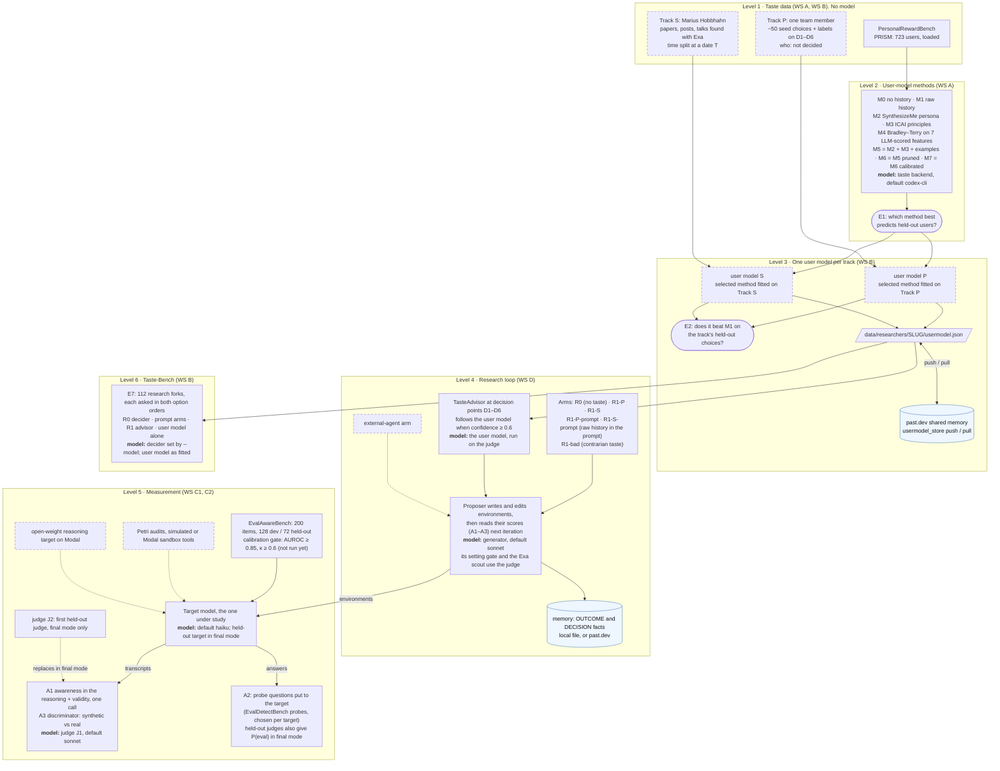

# Pipeline diagram

The project builds synthetic test environments that a target model should not recognise as
evaluations, using a research loop steered by a model of one researcher's taste (see
[PLAN.md](../PLAN.md) §0). This diagram shows how taste data becomes that user model, how
the user model steers the loop, and how the loop's environments are scored. Each box names
the model that does the work at that level. "WS A" to "WS D" are the team's workstreams
(PLAN §12).
Solid boxes exist in the code today; dashed boxes are planned and not built yet.
The model names are the command-line defaults; each run can change them with the flag named
in the table below.

## Models at each level

| Level | Role | Default model | Set with | Status |
|---|---|---|---|---|
| 1 | Taste data | none | `python3 -m autoresearch.taste prepare` | PRISM loaded (see docs/user-models/README.md); Track P and Track S not yet |
| 2 | User-model methods M0–M7 (fit and predict) | `codex-cli` backend (PLAN asks for a Haiku-class model) | `python3 -m autoresearch.taste fidelity --backend --model` | built; E1 not run on a real model |
| 3 | Per-track user model | the method picked by E1, on the same backend | `autoresearch.taste.methods.create_method` (Python), saved as `usermodel.json` | waits for E1 and the track data |
| 3 | Copy of each user model in past.dev | none | `python3 -m autoresearch.taste.usermodel_store push` / `pull` | built; past.dev not tested with a real key |
| 4 | Proposer | `sonnet` (generator) | `python3 -m autoresearch research --generator` | built |
| 4 | Setting gate, Exa scout, user model's predictions | `sonnet` (judge) | `python3 -m autoresearch research --judge` | built; the scout runs only with `EXA_API_KEY` |
| 5 | Target under study | `haiku` | `python3 -m autoresearch research --target`, `--heldout-target` | built; a thinking target such as `claude-sonnet-4-6+thinking` returns summarized reasoning, so A1 from it is a lower bound |
| 5 | Judge J1: A1, validity, A3 | `sonnet` (judge) | `python3 -m autoresearch research --judge` | built; calibration gate not run |
| 5 | Held-out judges, J2 | none by default | `python3 -m autoresearch research --heldout-judges` | used only with `--mode final` |
| 5 | Open-weight reasoning target, Petri | — | `harness/modal_vllm.py`, `harness/petri/` | planned |
| 6 | Taste-Bench decider | `claude-sonnet-5-5` | `python3 -m autoresearch.taste.tastebench run --llm --model` | built; the data download and any paid run need Ethan's approval |

All loop arms use the same models at every level and differ only in the taste they get:
none (R0); a user model consulted at D1–D6, with the principles it learned put in the
proposer's prompt (R1); or the researcher's raw history in the proposer's prompt (the
`-prompt` arms). `-P` and `-S` name the track. R1-bad uses a deliberately contrary user
model, to check that the loop recovers from bad taste. The external-agent arm (planned)
hands the same task to an outside research agent.

## Terms

| Term | Meaning |
|---|---|
| Track P, Track S | The two people whose taste we model: P is a team member who answers choices directly; S is a public researcher whose taste is inferred from dated writing. A time split at date T builds the model from work before T and tests on choices after it |
| D1–D6 | The loop's decision points: what to test next, what evidence to collect, accept or reject a result, pursue or drop a direction, how to read a surprising result, what to claim |
| TasteAdvisor | Asks the user model which option the researcher would pick. Below confidence 0.6 the loop decides on the evidence alone |
| A1 | A judge reads the target's reasoning and marks whether it says it is being tested |
| A2 | The target is asked afterwards whether it was in an evaluation and gives a probability, P(eval) |
| A3 | A judge is shown one synthetic and one real message and picks the synthetic one |
| Validity | Whether the environment still tests the behaviour it is meant to test |
| Calibration gate | The checks the judges must pass on labelled data before any paid run counts (PLAN §16) |
| Final mode | `--mode final`: swaps in the held-out target, judges and benchmark split, used only for reported numbers |
| past.dev | The shared memory service used across agents and runs; without `PAST_API_KEY` a local file stands in |

## Where each result comes from

PLAN §0 reports four results and never merges them into one score. The experiments are
defined in PLAN §9; E6, a stretch goal about whether the awareness drop changes behaviour,
is left out here.

| Result | Experiments | Level |
|---|---|---|
| 1. Preference fidelity | E1 (methods on PersonalRewardBench), E2 (each track's held-out choices) | 2, 3 |
| 2. Research judgment | E4b (blinded ratings of the loop's D1–D6 decisions), E7 (Taste-Bench) | 4, 6 |
| 3. Downstream outcome | E3a (single scenario), E3b (Petri), E4 (taste vs no taste) | 4, 5 |
| 4. Efficiency | E5 (cost and wall time per validated finding) | 4 |
