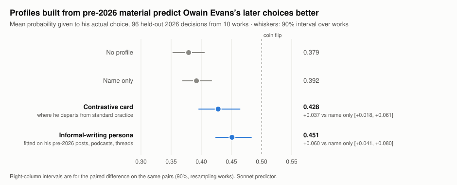
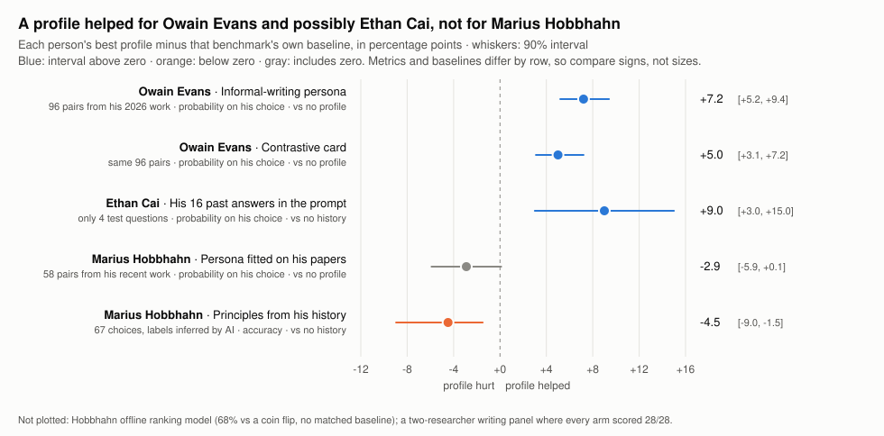
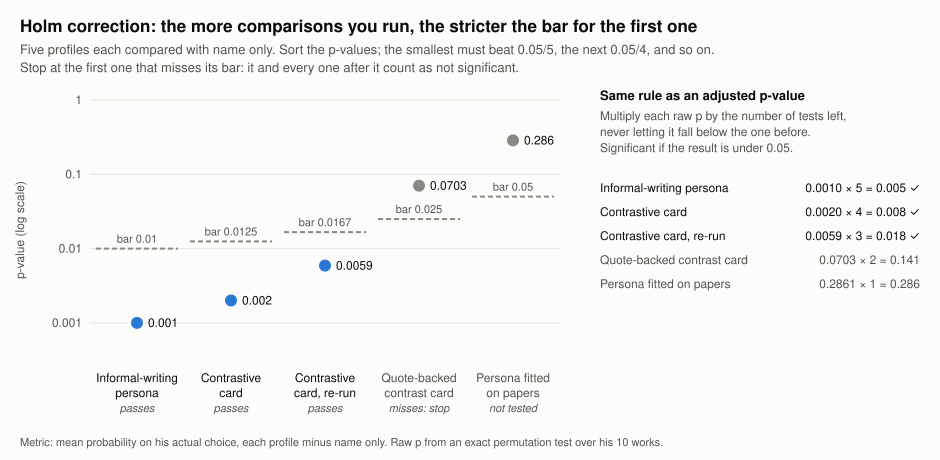

# Best held-out preference results (Owain Evans)

## Every person benchmarked on held-out preferences

`people.py` writes `people.svg` and `people.json` (each row's source). Rows differ in metric, baseline, model and
label source, so read signs, not sizes. Ethan's row rests on 4 test questions. Hobbhahn's development labels were
inferred by AI, not given by him. Hobbhahn's offline ranking model (68% on held-out documents) has no matched
no-profile baseline, and a two-researcher writing panel was at ceiling (every arm 28/28), so neither is plotted.

## What Holm correction does

Testing five profiles gives five chances to get a low p-value by luck. Holm's rule sorts the p-values and makes the
smallest beat 0.05/5, the next 0.05/4, and so on, stopping at the first miss. The chance of any false win stays at or
under 5% overall. It is less conservative than dividing every p-value by 5 (Bonferroni).

Test set: e2_v4's 96 post-T pairs (10 works), sonnet, both orders. Nothing new was run: `make.py` re-scores the cached
predictions and writes `results.json`, `figure.svg`, `holm.svg` and `profiles.md` (the two winning profiles, verbatim). Run it from
`experiments/taste_petri`. `figure.png` is a 2x render of the SVG.

**How the arms were picked.** Eligibility was fixed before scoring: a profile counts only if it was built from pre-T
material and never tuned on post-T pairs. That leaves name only, P1, P4, S_paper and S_inf, plus the climb-A confirmation run
(climb A accepted no step, so it is P4 re-run). Excluded: ANTI (written with post-T knowledge), H_B (tuned on post-T
pairs), and MIS and P0 (placebos, descriptive only). Tests are exact sign-flip permutations over works with Holm
correction across the eligible arms. The two runs of P4 differ by +0.000 [-0.006, +0.006] p(his choice), which is the
run-to-run noise.

**Result.** S_inf (+0.060, Holm p = 0.005) and P4 (+0.037, Holm p = 0.008) beat name only on mean p(his choice), and both
beat no profile. No arm beats name only on paired accuracy (best +0.031, p ≈ 0.3). S_inf and P4 do not separate from each
other (+0.023 [-0.003, +0.048], p = 0.10), so neither is "the" best.

**Caveats.** Every arm stays below 0.5 on his choice. The ANTI placebo, which says only "he departs from the cautious
default", reaches 0.496, so much of the gain may be that direction rather than knowledge of him. One researcher, 10
works: the smallest possible permutation p is about 0.001.
